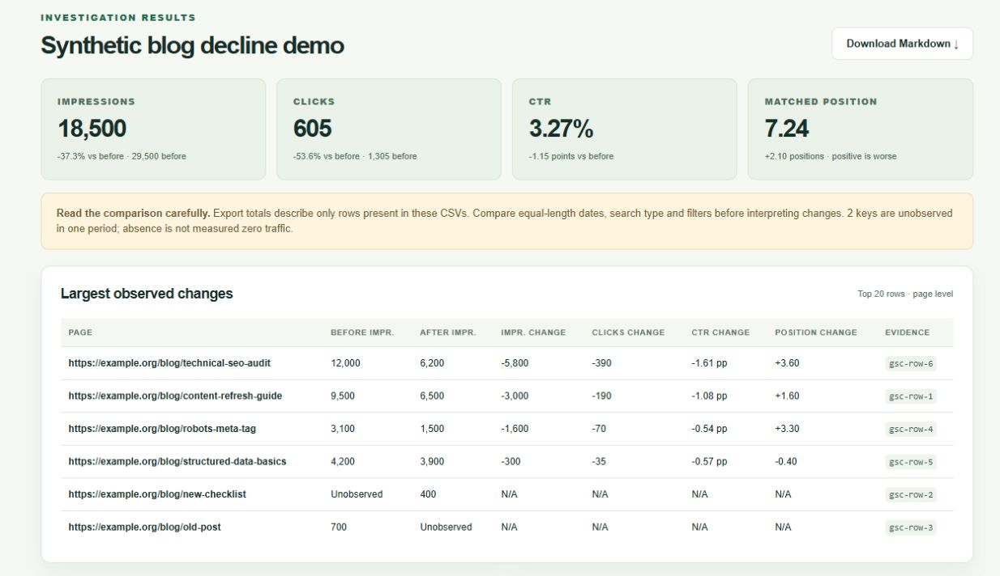
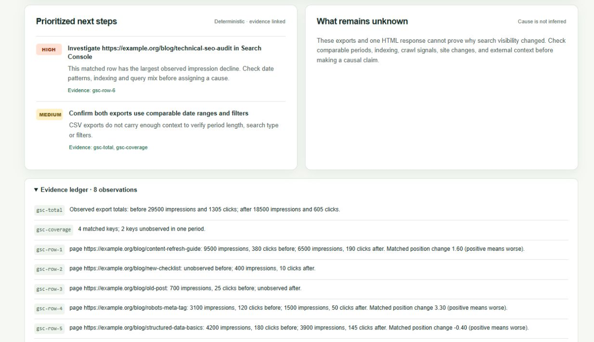
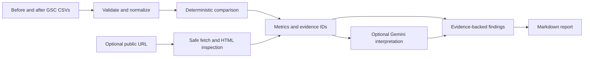

# SearchFix

**A local, evidence-first AI SEO investigator.** Compare Google Search Console (GSC) CSV exports, inspect a public page's returned HTML, and optionally ask Gemini for hypotheses tied to the observed evidence. SearchFix is a portfolio project with no account, database, or cloud infrastructure to operate.

## Application screenshots



*Dashboard: synthetic before/after exports show impressions, clicks, CTR, matched-key position, and the largest observed page changes.*



*Investigation results: each recommendation cites evidence IDs, while unknown causes remain explicit.*

Both images are real captures of the locally running application with the synthetic offline demo loaded. No Gemini key was entered.

## Features

- **GSC comparison:** upload before/after Pages or Queries CSVs. SearchFix validates columns and values, normalizes keys, aggregates duplicate rows, and calculates clicks, impressions, CTR, and position changes. Missing rows remain *unobserved*, and undefined ratios display as `N/A`.
- **Technical inspection:** fetch a public HTTP(S) page and inspect title, meta description, canonical, robots directives, headings, Open Graph properties, and JSON-LD. Concrete problems are separated from items that need human review.
- **Evidence-backed recommendations:** deterministic next steps cite the exact GSC row or technical observation that supports them. Optional Gemini output is labeled as hypotheses and validated against the same evidence IDs.
- **Markdown export:** download the comparison, findings, caveats, recommendations, and evidence ledger as a report.

## Getting started

Requires Node.js **20.9 or newer** and npm. From the project directory:

```bash
npm ci
npm run dev
```

Open <http://localhost:3000>. The dev and production scripts bind to `127.0.0.1`. To run the production build locally:

```bash
npm run build
npm start
```

A Gemini key is optional. Enter it in the app only when you want to run an AI investigation; do not put it in an environment file or commit it. SearchFix sends the supplied key to Gemini through its route handler, does not write it to application storage or logs, and clears the input after the request.

## Try the offline demo

Click **Load offline demo**. The included [`before.csv`](public/sample/before.csv) and [`after.csv`](public/sample/after.csv) are synthetic, equal-length blog snapshots using `example.org` URLs. The demo works without a Gemini key or a public website request. You can also upload those two files manually with **Pages** selected.

For your own data, export the Pages or Queries table from GSC Performance as CSV for two periods with the same date length, search type, and filters. The parser accepts `Page`/`Pages` or `Query`/`Queries`, plus `Clicks`, `Impressions`, and `Position` columns. It recalculates CTR from clicks and impressions rather than trusting the exported CTR column. Each CSV is limited to 2 MB and 10,000 rows.

## Architecture and engineering decisions



- [`src/lib/gsc.ts`](src/lib/gsc.ts) performs deterministic calculations. CTR is undefined with zero impressions; a percent change is undefined from a zero baseline. Position changes use only keys observed in both periods. An absent CSV row is never treated as measured zero traffic.
- [`src/lib/safe-fetch.ts`](src/lib/safe-fetch.ts) rejects local/private destinations, validates DNS addresses before connecting, pins the checked address, and rechecks every redirect. Fetches have time and HTML-size limits. [`src/lib/seo.ts`](src/lib/seo.ts) parses the returned HTML without running scripts.
- Next.js route handlers in [`src/app/api`](src/app/api) bound request bodies and return explicit errors with `Cache-Control: no-store`. The Gemini handler sends a bounded evidence set, requests structured JSON, and rejects malformed output or references to unknown evidence IDs. The model's interpretation cannot alter the deterministic metrics.
- [`src/lib/report.ts`](src/lib/report.ts) builds offline recommendations and the Markdown export. The client holds a BYOK key only in memory until the analysis request finishes.

## Technology stack

Next.js, React, TypeScript, Zod, `csv-parse`, Cheerio, `ipaddr.js`, and Vitest. There is no database, authentication layer, Docker setup, or deployment configuration.

## Tests and validation

```bash
npm test
npm run typecheck
npm run build
```

The completed MVP passed 21 focused tests, TypeScript checking, and a production build. The tests cover parsing, sparse and absent observations, comparison math, technical findings, public URL guards, Gemini response validation, route errors, and report claims. The offline demo and public HTML inspection were also checked in a running browser. This publication-preparation pass changes documentation and repository hygiene only.

## Known limitations

- CSV exports may omit rows and do not encode their date ranges or filters. SearchFix reports observed export changes, not complete site traffic or proven causes.
- Technical inspection is one fetched HTML response. It does not render JavaScript, inspect `robots.txt`, query Google's index, or establish why visibility changed.
- AI output is an unverified interpretation. Gemini has **not** been live-tested with a user-supplied key; the offline demo does not call Gemini. The app does not invent ranking data or traffic forecasts.

## License

SearchFix's own source is licensed under the [MIT License](LICENSE). Installed dependencies retain their respective licenses; `node_modules` and build output are excluded from this source repository.
